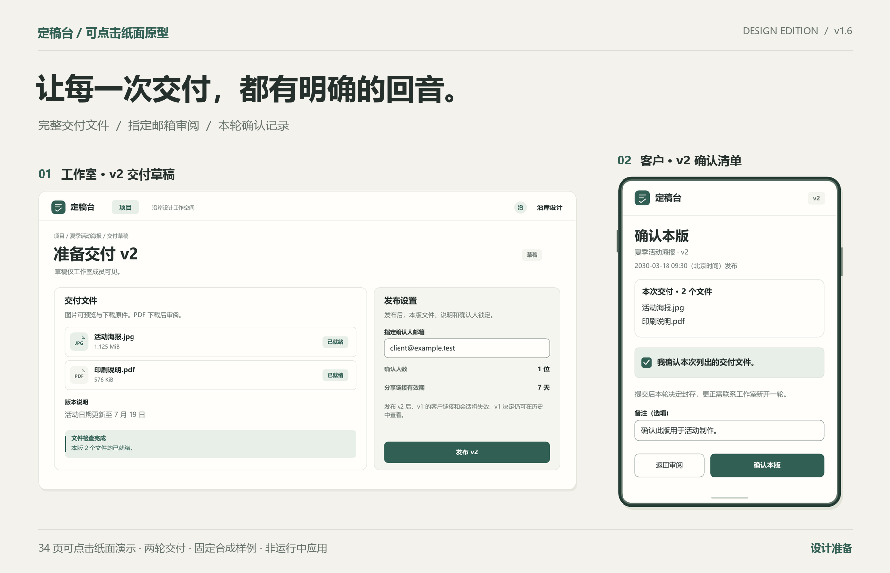
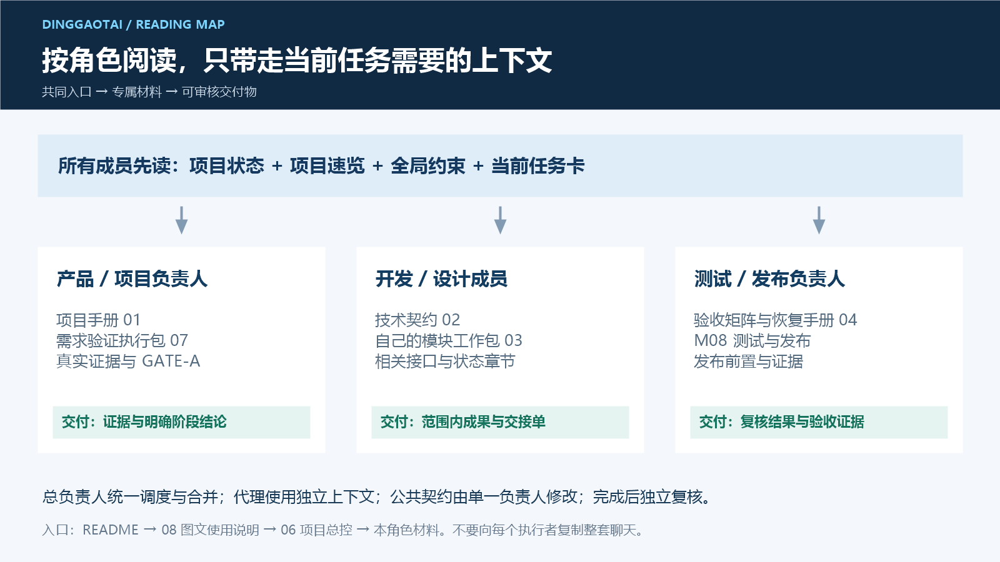
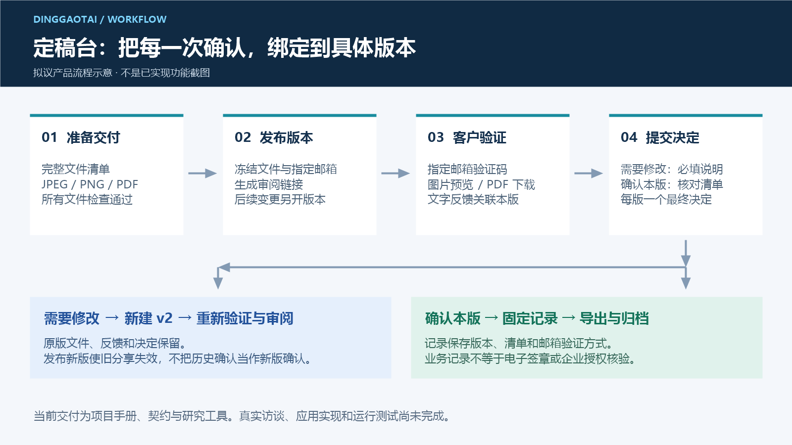
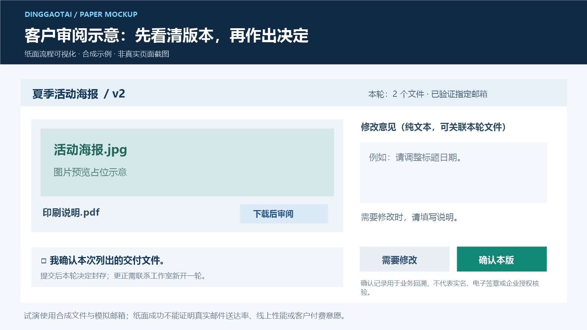
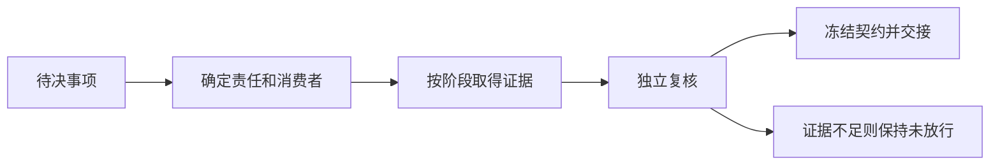

# 定稿台图文使用指南

定稿台面向小型设计工作室，拟让工作室和客户围绕同一份图片或 PDF 交付版本收意见、处理修改、确认并保留记录。这个仓库目前提供规划手册、协作模板和需求验证材料。真实问题访谈 **0/10**，真实纸面试演 **0/5**，GATE-A 尚未通过。产品尚未开发或上线，所有实际产品用例均未执行。最新进展见 [项目状态](../06_项目总控/01_项目状态.md)。

## v1.4怎样按职责接手

从[需求追踪表](../11_开发启动包/05_需求到验收追踪表.md)找到自己的需求，点开对应任务卡和契约。前后端核对[异常恢复路径](../11_开发启动包/07_异常状态与恢复路径.md)；通知、历史/设置、联调、恢复和发布负责人读取[后续工程卡](../11_开发启动包/06_后续工程任务卡.md)。无需把所有模块资料放进同一次任务上下文。

例如R07反馈：后端B04-FEEDBACK提供同轮评论接口，F01完成工作室在审回复，F02完成客户评论，F03只读历史。验收核对终态拒写、同轮附件、公开回复可见和同键不重复；PDF中的预置评论不能作为这些功能完成的证据。

## 五分钟起步

当前v1.6提供 [可点击纸面原型](../09_产品原型/定稿台_可点击纸面原型.pdf)。在GitHub打开PDF后下载到本地，用支持内部链接的阅读器查看；按钮跳转预设画面，模拟输入、复制、邮件、下载及提交均不执行真实操作。主持试演前先读 [原型边界](../09_产品原型/01_原型使用与边界.md)，角色切换只用独立研究工具栏。开发成员继续读 [启动顺序](../11_开发启动包/01_启动顺序与交接边界.md)，技术和测试读 [风险实验设计](../10_技术风险验证方案/01_实验清单与放行门槛.md)。

1. **第 1 分钟 · 打开仓库。** 在 GitHub 首页从 [README](../README.md) 进入。需要离线阅读时，在文件列表上方选择 **Code → Download ZIP**，解压后打开 `README.md`，保留原目录结构，让文档链接和配图可以找到对应文件。ZIP 是下载时的文件快照。[GitHub 下载说明](https://docs.github.com/en/repositories/working-with-files/using-files/downloading-files-from-github)
2. **第 2 分钟 · 确认阶段。** 看 [项目状态](../06_项目总控/01_项目状态.md) 和 [任务看板](../06_项目总控/02_任务看板.md)，确认现在能做的准备工作、卡在哪里，以及由谁跟进。
3. **第 3 分钟 · 了解范围。** 看 [项目速览](../00_协作入口/01_项目速览.md) 和 [全局约束](../00_协作入口/04_术语与全局约束.md)，了解用户、交付物和必须遵守的产品规则。
4. **第 4—5 分钟 · 找到自己的入口。** 按 [角色阅读地图](../00_协作入口/02_角色阅读地图.md) 找到任务卡及模块。负责验证时，从 [招募与访谈脚本](../07_需求验证执行包/01_招募筛选与访谈脚本.md) 和下文的记录流程开始。

## 按角色打开最少的材料

共同起点是项目速览、全局约束、任务卡和本模块工作包。首次加入补读 [交接规范](../00_协作入口/03_上下文隔离与交接规范.md)，其余资料按任务点开对应章节。

| 你负责什么 | 再打开这些材料 |
|---|---|
| 产品、项目统筹 | [项目手册](../01_项目手册/01_项目立项与选型.md)、[用户访谈与验证](../01_项目手册/03_用户访谈与验证.md)、[任务看板](../06_项目总控/02_任务看板.md) |
| 技术协调 | [技术总览](../02_开发手册/00_技术总览.md)、[状态机](../01_项目手册/05_业务流程与状态机.md)、[数据模型](../02_开发手册/01_数据模型.md)、[API 契约](../02_开发手册/02_API契约.md)、[权限与安全](../02_开发手册/03_权限与安全.md) |
| 前端、后端 | 前端看 [M06](../03_模块工作包/M06_前端体验.md)。后端从[角色阅读地图](../00_协作入口/02_角色阅读地图.md)选自己负责的领域包。两者都按任务查相关状态、接口和权限 |
| 测试、运维 | [M08](../03_模块工作包/M08_测试与发布.md)、[测试与验收矩阵](../04_上线与运营/01_测试与验收矩阵.md)、[部署与发布手册](../04_上线与运营/02_部署与发布手册.md)、[备份与事故处理](../04_上线与运营/03_备份与事故处理.md) |
| 研究、客服、运营 | [访谈脚本](../07_需求验证执行包/01_招募筛选与访谈脚本.md)、[试点与运营](../04_上线与运营/04_试点与运营.md)、[隐私与服务边界](../04_上线与运营/05_隐私与服务边界.md) |

*图 1　先读共同材料，再沿自己的角色路径打开任务所需的文档。*

## 有对象后，怎么填 10 次访谈和 5 次试演

1. **V01 · 访谈。** 获准开展后，按[脚本](../07_需求验证执行包/01_招募筛选与访谈脚本.md)筛选 2—10 人的工作室，核对过去一个月至少 2 次交付、图片或 PDF 占至少一半，以及受访者亲自经手最近的交付。说明匿名笔记并征得同意。先问最近一单和近三个月的具体问题，最后才展示方案。每次访谈填[证据记录与评分表](../07_需求验证执行包/03_证据记录与评分表.md)的一行，分开记原话、观察、解释与反例，并记录真实项目的预计开始日期。联系方式另行受控保存。访谈只需匿名笔记，客户原稿和完整聊天无需采集。
2. **V02 · 试演。** 按[纸面试演](../07_需求验证执行包/02_纸面流程试演.md)逐张展示参与者卡片，通过模拟邮箱完成两轮。主持人只读任务，逐字记下额外提示，同时记首次动作、耗时、卡点和是否独立完成。解释限制前，先请参与者说出对版本、决定及记录的理解。每场填评分表一行，标明角色和中止、跳过等情况。缺少真实客户指定确认人代表时，标记 H03 邮箱接受度缺证。
3. **V03 · GATE-A。** 按[评审单](../07_需求验证执行包/04_GATE-A评审单.md)核对适格样本、同意、分子/分母、观察窗、排除原因和反例。访谈通过线为至少 6/10 有近三个月具体版本或确认问题、至少 5 家愿试演、至少 3 家能给出两周内开始的真实项目。试演通过线为至少 4/5 无关键提示完成、0 人误认已签署法律合同、至少 3 家接受限制并愿提供真实项目。总负责人汇总证据并组织评审。访谈未达标时暂停开发，可调整一次用户细分再验证，第二轮仍失败则结束立项。继续进入下一阶段须有真实证据和评审结论。

## 任务如何从领取走到交接

以“核对纸面卡片里的 PDF 审阅文案”为例。总负责人从[看板](../06_项目总控/02_任务看板.md)分派任务，使用[任务卡](../05_协作模板/01_任务卡.md)定清负责人、验收人、工作范围和交付位置。执行者对照全局约束 G04 核查每张相关卡片，将证据写为“卡 2、5、8 均为 PDF 下载审阅”，并附文件位置。验收人按[审校记录](../05_协作模板/05_文档审校记录.md)核验，执行者用[交接单](../05_协作模板/02_交接单.md)交付文件、发现及待验证事项。涉及公共规则冲突时，用[变更记录](../05_协作模板/03_变更与决策记录.md)提交总负责人。由总负责人确认验收、关闭任务并更新总控。

## 拟议产品如何完成一次交付

*图 2　拟议产品的业务流程，供理解方案；功能尚未实现。*

工作室创建项目，上传图片和 PDF，文件检查通过后发布 v1 并分享给一位指定确认人。客户验证邮箱后预览图片、下载 PDF、填写意见，并提交“需要修改”。本轮决定随即封存。工作室新建并发布完整的 v2，v1 的分享和客户会话失效，历史决定保留。客户到 v2 再次验证邮箱，核对文件清单后确认，工作室查看或导出本轮记录。正式规则见[业务流程与状态机](../01_项目手册/05_业务流程与状态机.md)。

*图 3　早期业务结构示意，保留用于理解流程；当前视觉以本指南顶部的v1.6原型为准。全部为纸面示意，非真实产品截图。*

## 常见口径和下一步

- **表已备好，能记多少？** 只记实际采集且可追溯的结果。无人参加时保留空槽，汇总写“未采集（0/0，不计算百分比）”。同一团队重复参加只计一家，模拟和口头好评按原样记录。
- **邮箱验证和记录能证明什么？** 验证表明确认人当时能接收指定邮箱的验证码。导出留存业务决定，签章、合同签署、企业授权核验均超出首版能力。纸面试演只衡量给定卡片与模拟邮箱下的表现。
- **现在从哪接着做？** 先按[任务看板](../06_项目总控/02_任务看板.md)完成获准的材料审校和交接。等有适格对象并获准执行后，从 V01 开始采集，再推进 V02、V03。GATE-A 通过后由总负责人安排 T01。产品测试、发布与付费验证以各阶段的实际记录为准。

## v1.5开工前如何交接

技术负责人从[T01清单](../11_开发启动包/08_T01待决项与冻结清单.md)选取本次要关闭的事项，查已定边界、证据和受影响任务；负责运营后台的人读[三项操作规格](../02_开发手册/08_受控运营操作规格.md)。所有成员可以照[已填交接实例](../11_开发启动包/09_验收证据与交接实例.md)填写交接，先区分文档审校、模拟和真实运行。

当前没有技术实验或产品测试记录。实例中的v1.4文档检查是真实历史交付；拒收示例只是判定练习，不能填写到真实访谈或验收记录里。

## v1.6怎样查看视觉完善

先看本页顶部的桌面与手机预览，再下载[34页原型PDF](../09_产品原型/定稿台_可点击纸面原型.pdf)。从第1页选择角色，在第15页查看工作室发布设置，在第22/23页对照确认前后，在第26页看固定记录；第29—32页检查上传失败、结果未知、链接不可用和只读。按钮仅跳转预设画面。

设计和前端从[视觉规范](../09_产品原型/03_界面视觉规范.md)领取颜色、字体、间距、组件及状态要求，结合[页面清单](../09_产品原型/02_页面与跳转清单.md)和自己的任务卡实施。全局字段与权限仍以公共契约为准；本次视觉交付不代表网页、手机适配或无障碍功能已经实现。
