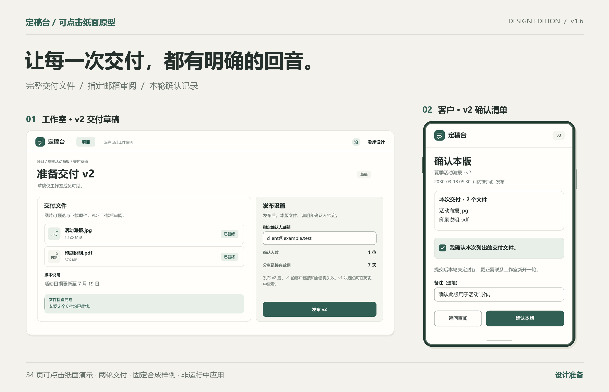

# 定稿台可点击纸面原型

v1.6 视觉完善 · 2026-11-26；沿用v1.3两轮流程和合成数据。

[打开可点击原型](定稿台_可点击纸面原型.pdf) · [查看页面与跳转清单](02_页面与跳转清单.md) · [界面视觉规范](03_界面视觉规范.md)

## 开始试演

下载 PDF，用支持页内链接的阅读器打开，从第 1 页进入工作室。界面操作在产品画面内，底部深墨色「原型工具」用于切换角色、打开模拟收件箱、进入故障分支或回到入口。阅读器若无法跳转，可按[跳转清单](02_页面与跳转清单.md)中的页码定位。

样例为沿岸设计的「夏季活动海报」。两轮文件均名为「活动海报.jpg」和「印刷说明.pdf」，v2 的两个文件从空草稿完整上传，使用本轮文件对象。两轮指定同一邮箱 `client@example.test`，每轮分别发码与验证。v1 的活动日期为 7 月 12 日，客户提出更正为 7 月 19 日。v1 终态为「需要修改」，v2 终态为「已确认」，工作室历史保留两轮决定。原型与开发启动包使用同一组业务样例，其中 2030 年的时间是合成值。参见[合成数据与页面接口映射](../11_开发启动包/03_合成数据与页面接口映射.md)。

个人演示时，按界面操作推进。每轮发布及提交决定后可用页底工具切换角色。图片预览展示当前版本的示意海报，PDF 附件在审阅页显示下载入口。内部「查看确认记录」提供 v2 固定快照的 JSON 下载示意与打印视图。

## 主持人与观察者

使用[纸面流程试演](../07_需求验证执行包/02_纸面流程试演.md)的任务原文与记录办法。按轮次展示角色对应的界面或裁切后的卡面，由主持人控制试演入口和页底工具。每轮分别提供模拟邮箱卡。原型预设邮箱、验证码、修改说明和确认备注。若需观察参与者独立输入，使用空白纸面卡，将其输入和主持人代操作分别记录。

按[证据记录与评分表](../07_需求验证执行包/03_证据记录与评分表.md)记录首次动作、回退、停顿、原话、耗时与任何提示。是否愿意用指定邮箱、如何理解确认记录等问题，在任务结束后询问。工作室成员代演客户时，按试演规则记录角色替代与证据缺口。

## 覆盖与边界

| 可在 PDF 中操作 | 有待真实条件验证 |
|---|---|
| 工作室从项目发出 v1，读取修改结果，准备和发出完整 v2，查看历史及 v2 记录 | 内部登录与邀请，真实项目及附件服务，文件传输与检查，真实分享密钥，历史记录持久化 |
| 客户两轮独立验证、查看图片、点击 PDF 下载、提交修改说明、勾选清单并确认 | 邮件与验证码送达、文本输入、倒计时与限流、图片原件与 PDF 下载、独立评论写入、真实决定与并发 |
| 上传失败后重试、决定结果未知时查询、过期或撤销链接的通用提示、空间只读仍可查看记录 | 网络时序与自动轮询、鉴权与撤销、服务端写入及只读保护 |
| 手机客户与桌面工作室主线，附桌面客户和手机工作室对照 | 360 px、真实设备、键盘与读屏、浏览器及微信、真实导出与分页打印 |

复制、下载、验证码发送、上传和导出都通过页内跳转演示。界面字段只显示固定样例。v1 审阅画面展示一条已存在的附件反馈，撰写和发送该反馈未纳入原型操作。步骤外的 v1 确认和 v2 要求修改可点到范围说明。只读视图与正常历史是独立的纸面状态，跨页跳转不携带实时空间状态。记录中的原件摘要和快照摘要是占位，实际摘要须通过测试文件与正式快照验证。

单个版本只允许该轮指定邮箱作出一次决定。发布 v2 后，v1 的外部分享链接和会话失效，内部保留 v1 决定。邮箱验证表示当时能够接收验证码。确认记录仅作为本轮业务记录，无法证明实名、公司授权或法律签章。PDF 附件设计为下载审阅。

本交付完成原型制作和 PDF 文件检查。真实试演样本为 0，GATE-A 未通过，T01、应用实现及产品用例均未执行。
