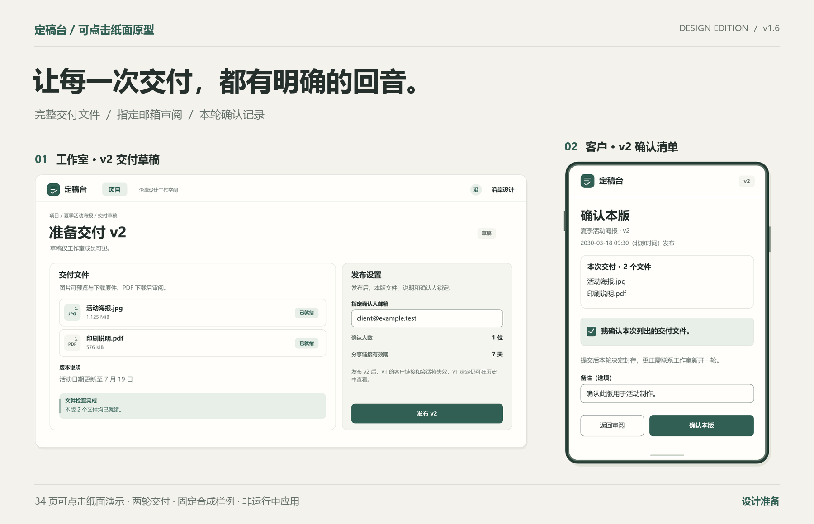

# 界面视觉规范

v1.6 · 2026-11-26。适用：设计、F01工作室页面、F02客户审阅、F03历史与设置。当前交付为[纸面原型](定稿台_可点击纸面原型.pdf)和设计约束，尚无浏览器实现。业务规则以[全局约束](../00_协作入口/04_术语与全局约束.md)为准；异常行为以[恢复路径](../11_开发启动包/07_异常状态与恢复路径.md)为准。视觉样式不能改变权限、发布条件或决定结果。

## 视觉方向与信息优先级

让页面像设计工作室整理好的交付稿：暖白留白、深墨文字、青绿主操作、细线分组。保留完整文件名、版本、状态、确认人和下一步操作；装饰围绕这些内容安排。每个任务区域只有一个最主要操作，同级操作采用相同外观。

桌面端优先看清「正在准备哪一版、交付什么、发给谁」；客户端优先看清「我正在审哪一版、有哪些文件、决定后会怎样」。结果页先给出结果文字，再列时间和说明。异常页先解释当前能否继续，再给真实可用的下一步。

## 色彩

| 名称 | 色值 | 用途 |
|---|---|---|
| 暖纸背景 | `#F4F2ED` | 展示画布、外围背景 |
| 纸白 | `#FFFEFB` | 主要内容、表单与卡片 |
| 深墨 | `#252F2C` | 标题、正文、关键数字 |
| 辅助灰 | `#66716B` | 时间、解释、次要信息 |
| 青绿 | `#315F53` | 主按钮、当前步骤、可操作强调 |
| 浅绿 | `#E8EFE9` | 成功说明、已勾选清单的背景 |
| 分隔线 | `#DCDDD5` | 区块分隔、非交互卡片的细线 |
| 控件边界 | `#7D8982` | 可输入区域和复选框的可辨边界 |
| 琥珀 | `#805E32` | 待处理、只读、结果待核实 |
| 错误红 | `#A14C43` | 失败提示及与修复操作相关的标记 |

青绿不自动表示成功；按钮代表动作，状态必须另有明确文字。成功、待处理、失败至少同时有文字说明，必要时增加符号，不能只看红绿区别。分隔线色较浅，不作为输入框、焦点或复选框的唯一边界。海报示意图可使用独立配色，不将其中颜色扩展成产品状态。

## 字体、尺寸与留白

本次 PDF 使用系统微软雅黑常规/粗体并嵌入字体。后续网页优先系统中文无衬线字体，英文和数字使用同一字体族的系统回退；不增加付费字体采购。本轮纸面尺寸是排版坐标，不能把缩小后的截图像素直接当作网页尺寸。

| 项目 | 网页设计目标（CSS px，待实现） | 使用规则 |
|---|---|---|
| 页面标题 | 桌面32、手机26，行高约1.3 | 一页一个主标题；长项目名允许换行 |
| 区块标题 | 18–20，行高1.4 | 解释当前分组，不全页粗体 |
| 正文/输入 | 16，行高1.5 | 关键说明不通过缩字号塞入卡片 |
| 元信息 | 13–14，行高1.5 | 时间、文件大小、辅助提示 |
| 主操作/输入高度 | 44 | 手机点击区域不随文字缩小 |
| 圆角 | 按钮8、卡片12 | 手机外壳只用于展示，不进入产品页面 |
| 基础间距 | 4、8、12、16、24、32 | 同组紧、组间松；按钮之间至少8 |

PDF为完整流程展示会使用更紧凑的正文与注释，实际数值见本轮[视觉交付报告](../06_项目总控/09_v1.6视觉完善交付报告.md)。网页实现以可读性目标为准，需要滚动时允许页面变长。不能用固定高度裁切长文件名、错误提示或确认说明。

## 组件与状态

| 组件 | 正常外观 | 必须保留的状态/行为 |
|---|---|---|
| 主按钮 | 青绿底、纸白文字、明确动词 | 未就绪禁用并说明原因；提交中标明正在处理，结果未知不能显示成功 |
| 次按钮 | 纸白底、深色文字与可辨轮廓 | 与主操作有层次；返回操作不得清除尚可合法保留的输入 |
| 文件行 | 类型标记、完整名称、大小、状态 | JPG/PNG可预览；PDF写明下载审阅。检查失败保留修复入口；未就绪不能发布 |
| 表单 | 标签在输入框外、内容左对齐 | 必填与选填写清；错误出现在对应字段旁，不只靠变红 |
| 版本标签 | 简短编号与状态 | 草稿、在审、需要修改、已确认分开；修改必须新版本 |
| 确认清单 | 本轮文件清单与勾选项 | 未勾选不可提交；勾选后保留「本轮结束」说明，不默认勾选 |
| 提示条 | 低饱和背景、短标题、可行动说明 | 成功、失败、等待、只读不能共用成功图标或成功措辞 |
| 空态 | 简短说明及当前允许的操作 | 没有文件与加载失败分开；无权限时不能放出旧数据 |
| 记录页 | 结果、版本、邮箱、时间、文件清单分组 | 固定快照独立于当前编辑态；不加签章、认证或法律存证图标 |

交互设计需补充键盘焦点、悬停、按下、加载、错误和禁用状态；这些动态状态当前只规定，不声称 PDF 已实现。焦点采用清晰外环并与相邻背景分离，不使用只有轻微颜色变化的效果。提交结果待核实期间保留原请求的查询入口，不能用第二个醒目的提交按钮诱导重复操作。

## 布局与内容适应

- 桌面草稿采用文件为主、发布设置为辅的两栏；窄屏按文件、说明、确认邮箱、发布操作顺序堆叠。页面内容最大宽度建议1120，桌面外侧留24–32，手机外侧留16。断点由长内容验证决定。
- 客户端单列，主要动作放在本轮文件和确认说明之后。若未来使用固定底部操作条，须为正文和键盘留空间，不遮住最后一条文件或错误说明。
- 至少覆盖360宽度、文字放大200%、长中文文件名、邮箱折行及20份附件。显示省略名时须有键盘及触摸均可查看全名的入口；确认清单不得只呈现不可展开的截断名称。
- 超时、撤销和身份切换必须清空旧轮受限内容；不可为保持画面丰满继续显示旧缩略图。只读空间保留允许读取的历史，删除阶段按角色权限单独处理，不能用一种灰色蒙层替代所有状态。
- 打印页用浅底和文字层级，重复必要的项目/版本信息，避免跨页截断文件行；黑白打印也能识别结果。PDF第28页只是预设打印示意，真实长清单分页仍待F03/Q02验证。

## 可读性依据与交付检查

普通文字与背景采用至少4.5:1的设计检查线，适用大字可采用3:1；判定使用未舍入数值。依据：[W3C文字对比度说明](https://www.w3.org/WAI/WCAG22/Understanding/contrast-minimum.html)（2026-11-26核对）。网页主要控件采用44×44的项目目标；WCAG 2.2 AA的目标尺寸条款为24×24并包含间距等例外，不能把44误写成AA统一要求。[W3C目标尺寸说明](https://www.w3.org/WAI/WCAG22/Understanding/target-size-minimum.html)

本轮检查限定为色值配对、PDF排版与跳转。实际浏览器的焦点顺序、语义标签、读屏、缩放和触控未验证，不能据此宣布无障碍合规。

| 检查项 | 纸面交付要检查 | 后续实现负责人及证据 |
|---|---|---|
| 同一产品语言 | 全部页面的颜色、标题、卡片、按钮一致 | F01/F02/F03：真实页面截图及样式表 |
| 决定安全感 | 22/23页未勾选与已勾选明确，30页不伪报成功 | F02/Q02：禁用、幂等、网络未知结果记录 |
| 内容保真 | v1/v2日期、邮箱、文件名和26–28页记录一致 | F03/Q02：真实数据与导出对照 |
| 可读性 | 字体显示正常，正文无裁切，颜色配对可读 | F01–F03/Q02：360宽度、放大、键盘、读屏 |
| 文件交付 | 全页重渲染、有效跳转、预览来自最终PDF | 总负责人：文件指纹、页数与链接检查 |

设计和前端接手时，最小上下文为本页、对应页面清单、M06及当前任务所需契约；无需加载其他模块历史。新增页面沿用这些规则，但须先覆盖自身异常状态再交付。原型没有展示的功能仍按需求验收，不因视觉规范省略而删除。
