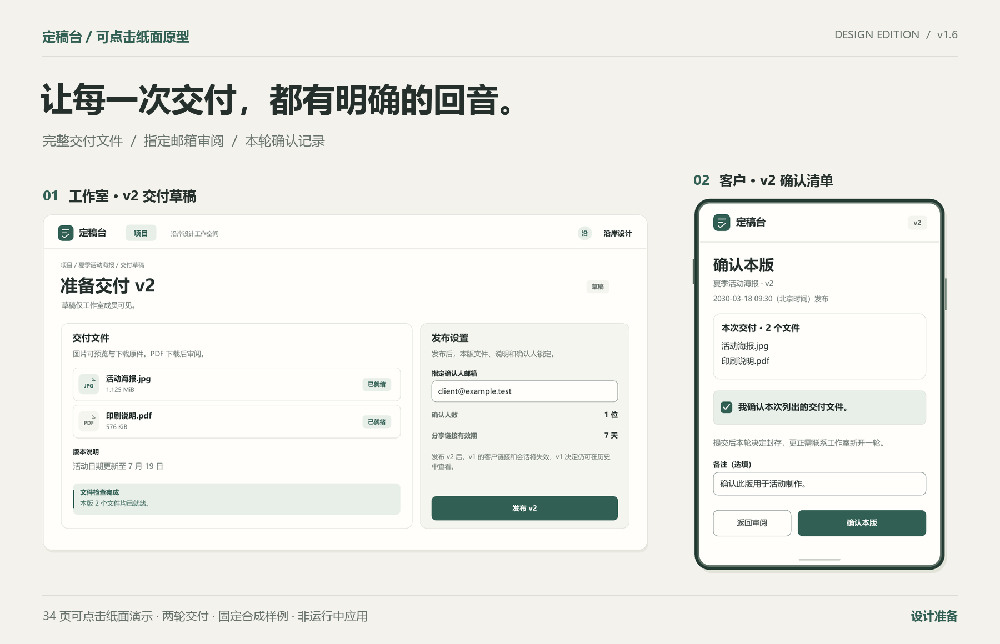
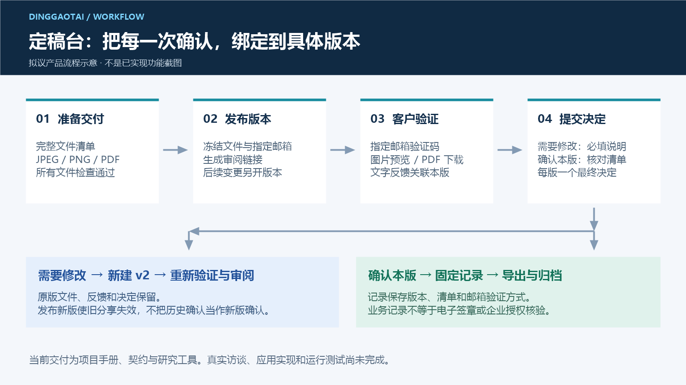

# 定稿台｜项目与开发手册

版本：规划基线 v1.6 · 更新日期：2026-11-27 · 阶段：原型与开发准备，待真实用户验证。

**一句话：让小型设计工作室与客户围绕同一份交付版本反馈、修改和确认，减少“到底确认了哪一版”的混乱。**

本文件夹是可交接的规划文档，不包含应用代码、脚手架或部署配置。产品尚未开发、尚未上线，也尚未验证付费需求。技术可行性、商业假设、外部事实在文档中分别标注。

**首次阅读请打开 [图文使用指南](08_使用说明/图文使用指南.md)**，五分钟了解阅读顺序、分工、验证记录和交接方法。

**可演示材料：** [可点击纸面原型 PDF](09_产品原型/定稿台_可点击纸面原型.pdf) · [原型使用边界](09_产品原型/01_原型使用与边界.md) · [8项技术风险实验设计](10_技术风险验证方案/01_实验清单与放行门槛.md) · [开发启动包](11_开发启动包/01_启动顺序与交接边界.md)。PDF只在预设画面间跳转，不实际上传、发邮件或提交决定；请下载后用支持PDF链接的阅读器打开。

总负责人已接管调度。当前真实状态与任务入口见 [项目状态](06_项目总控/01_项目状态.md) 和 [任务看板](06_项目总控/02_任务看板.md)；无代码研究材料见 [需求验证执行包](07_需求验证执行包/01_招募筛选与访谈脚本.md)。目前仍先完成验证准备；用户另已授权审核后新建 GitHub 仓库上传文档，应用开发与生产部署尚未启动。

**v1.6界面视觉：** [34页可点击原型](09_产品原型/定稿台_可点击纸面原型.pdf) · [视觉规范与开发交接](09_产品原型/03_界面视觉规范.md)。暖纸底色、墨绿主操作、统一桌面与手机界面；流程仍为纸面模拟。

**v1.4新增交接入口：** [需求到验收追踪](11_开发启动包/05_需求到验收追踪表.md) · [6张后续工程任务卡](11_开发启动包/06_后续工程任务卡.md) · [21项异常与恢复路径](11_开发启动包/07_异常状态与恢复路径.md)。该轮补齐责任和签收条件；当前原型视觉版本为v1.6。

**v1.5开工准备：** [运营开通/续期/冻结规格](02_开发手册/08_受控运营操作规格.md) · [9项T01待决与冻结清单](11_开发启动包/08_T01待决项与冻结清单.md) · [证据包与已填交接实例](11_开发启动包/09_验收证据与交接实例.md)。明确哪些规则已经确定、哪些结论必须取证，以及下一位成员如何检查交接。

## 从这里开始

1. 所有人先读 [项目速览](00_协作入口/01_项目速览.md) 与 [全局约束](00_协作入口/04_术语与全局约束.md)。
2. 在 [角色阅读地图](00_协作入口/02_角色阅读地图.md) 找到自己的阅读路径。
3. 按 [上下文隔离与交接规范](00_协作入口/03_上下文隔离与交接规范.md) 领取一个任务，加载对应模块包和所需契约。
4. 尚未立项时，先执行 [需求验证](01_项目手册/03_用户访谈与验证.md)。验证门槛通过后再启动开发。

## 文档导航

| 目录 | 回答的问题 | 主要读者 |
|---|---|---|
| [00 协作入口](00_协作入口/02_角色阅读地图.md) | 这是什么、我应该读什么、如何交接 | 全体 |
| [01 项目手册](01_项目手册/01_项目立项与选型.md) | 为什么做、做什么、谁来做、何时做、何时停止 | 产品、项目负责人 |
| [02 开发手册](02_开发手册/00_技术总览.md) | 如何实现、数据与接口如何一致 | 技术负责人、开发 |
| [03 模块工作包](00_协作入口/02_角色阅读地图.md) | 我的边界、输入输出、具体任务和验收 | 各模块负责人 |
| [04 上线与运营](04_上线与运营/02_部署与发布手册.md) | 怎样测试、上线、恢复、获客和服务 | 测试、运维、运营 |
| [05 协作模板](05_协作模板/01_任务卡.md) | 如何记录任务、变更、交接和发布证据 | 全体 |
| [06 项目总控](06_项目总控/01_项目状态.md) | 实际状态、团队、任务、审查与变更 | 总负责人、用户 |
| [07 需求验证执行包](07_需求验证执行包/04_GATE-A评审单.md) | 如何招募、访谈、纸面试演和评审真实证据 | 产品研究执行人 |
| [08 图文使用说明](08_使用说明/图文使用指南.md) | 如何浏览、领取任务、填写证据、理解拟议产品 | 新成员及非技术读者 |
| [09 产品原型](09_产品原型/01_原型使用与边界.md) | 两轮交付怎样操作，失败状态怎样恢复 | 产品、设计、研究、前端 |
| [10 技术风险验证方案](10_技术风险验证方案/01_实验清单与放行门槛.md) | 如何实测关键假设，失败或缺证据怎样阻断与决策 | 技术、测试、运维 |
| [11 开发启动包](11_开发启动包/01_启动顺序与交接边界.md) | 字段样例、合成数据、页面接口和首批任务怎样衔接 | 前后端、测试、技术负责人 |

## 计划基线

- 目标用户：2—10 人的中文品牌设计、电商视觉、平面设计工作室；首批只招募图片和 PDF 交付占主导的团队。
- 首版：响应式 Web；一个工作空间、内部两种角色、每次发布一名指定客户确认人；PNG/JPEG 预览、PDF 下载审阅；版本反馈、确认记录、链接撤销、记录导出。
- 技术建议：Vue 3 + TypeScript；Django 5.2 LTS + Django REST framework；PostgreSQL 17；私有对象存储；数据库任务队列。采用模块化单体。
- 排期：约 2 周需求验证、8 周研发验收、2 周真实试点，合计约 12 周；两名主力开发及兼职产品、设计、测试、运维按人日投入。外部手续及用户观察周期可能使公开上线延后。
- 资源：计划容量 132 人日；其中任务估算 118 人日、机动 14 人日。费用均为模型估算，不是采购报价。
- 判定成功：客户真实完成确认、团队愿意再次使用，并出现可核实的付费行为；不是以功能数量判定。

## 规则与证据的权威位置

全局限制以 [全局约束](00_协作入口/04_术语与全局约束.md) 为准；流程以 [状态机](01_项目手册/05_业务流程与状态机.md) 为准；字段以 [数据模型](02_开发手册/01_数据模型.md) 为准；调用以 [API 契约](02_开发手册/02_API契约.md) 为准。发现冲突时提交变更记录，不能由单个模块自行决定。

外部事实与来源集中在 [调研证据](01_项目手册/02_调研证据与假设.md)。阅读时注意查询日期；正式开工和采购时重新核验软件补丁版本、云服务价格与上线要求。

当前访谈 **0/10**、试演 **0/5**，GATE-A 未通过。准备阶段交付和遗留门槛见 [交付报告](06_项目总控/05_准备阶段交付报告.md)。待有适格对象并获准执行后开展 V01/V02，证据齐备再形成 V03。文件、图片和审查报告不替代真实访谈、功能实现或产品测试通过。

v1.3新增范围与核验结果见 [v1.3交付报告](06_项目总控/06_v1.3准备完善交付报告.md)。历史v1.2报告中的文件数与上传记录保留原时点含义。

v1.4范围与审核结果见[协作闭环交付报告](06_项目总控/07_v1.4协作闭环交付报告.md)。每份材料只支撑其已核验层级；GATE-A仍待真实证据，未启动应用研发。

v1.5范围、独立复核及文件核验见[开工准备交付报告](06_项目总控/08_v1.5开工准备交付报告.md)。

v1.6视觉范围与核验见[视觉完善交付报告](06_项目总控/09_v1.6视觉完善交付报告.md)。
